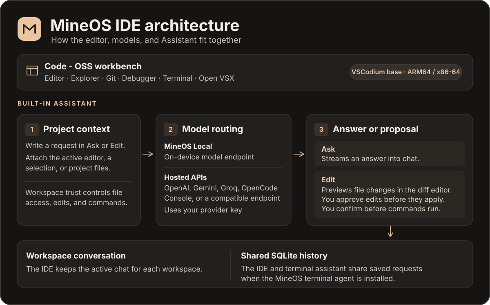

# MineOS IDE

MineOS IDE uses the Code - OSS workbench through a checksum-pinned VSCodium release. The original upstream license files stay in the package. The bundled MineOS Assistant uses public extension APIs and has no npm runtime dependencies. The workbench keeps its native editor, Git tools, debugger, terminal, settings, theme picker, and Open VSX extension browser.

## Install in MineOS

The live ISO includes MineOS IDE in the Applications menu. On an existing installation, run from the repository root in a Linux desktop session as your normal user.

    bash ide/install.sh
    ~/.local/bin/mineos-ide /path/to/project

The installer supports ARM64 and x86-64. It installs the editor in the user's data directory and adds MineOS IDE to the application launcher. Run the installer again after changing the bundled extension. Reopen the editor to load changes. It uses a separate user profile and extension directory. Set MINEOS_IDE_DISABLE_GPU=1 to switch the launcher to software rendering when needed.

## Assistant

Open MineOS from the activity bar, or use **MineOS: Open Assistant Beside Editor** from the Command Palette. Choose **Ask** for explanations and **Edit** for proposed workspace changes. Attach the active editor, a selection, or specific project files. Proposed file edits open in the native diff editor and apply on request. Terminal commands, including package installs, require approval and run in the selected project folder.

Open **Model settings** to choose MineOS Local, OpenAI, Gemini, Groq, OpenCode Console, or an OpenAI-compatible endpoint. Hosted services use a compatible chat-completions model and a provider key where required. The extension uses VS Code SecretStorage for keys and keeps them in memory for the session if the operating system keyring is unavailable. Provider availability, model access, and billing depend on the provider. OpenCode Console documents separate limits on its free chat models in third-party clients.

The default local endpoint follows the installed MineOS terminal agent's configuration when it points to a loopback model server. The IDE retains the working conversation per workspace. Shared history uses the terminal agent's SQLite database and preserves new IDE and Terminal transcripts. Older entries retain their previously saved summaries. Use **ai --history** or the Assistant's history view to browse both tools. The IDE uses its own current conversation and selected files when building model prompts. Shared history entries can be reused explicitly.
